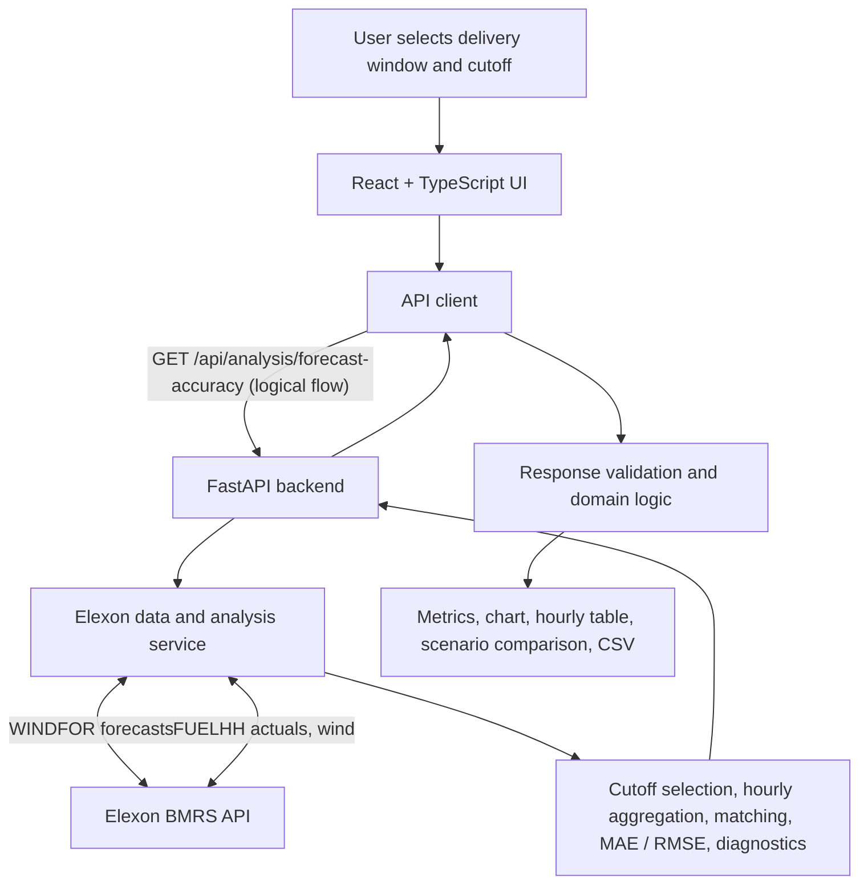

# WindLens

**See the wind forecast that was actually available when the decision had to be made.**

[Live demo](https://windlens-five.vercel.app/) · [Features](#features) · [Methodology](#methodology) · [Architecture](#architecture) · [Run locally](#getting-started) · [Docker](#docker) · [Testing](#testing)

---

WindLens is a historical analysis tool for Great Britain wind generation. Choose a **delivery window** and a **decision cutoff**, and it reconstructs the latest forecast that had been published by that cutoff, measures it against actual generation, reports how complete the underlying data is, and lets you compare how forecasts changed between two decision times.

It is built for analysts reviewing day-ahead electricity procurement decisions. It is a backtesting and review tool. It is not a real-time forecasting service, a trading platform, or a cost or profit calculator.

## The problem

Wind forecasts are republished as new information arrives. If you judge a past procurement decision against whichever forecast is available *today*, you are using information the decision-maker never had. This is look-ahead bias, and it makes historical forecasts look better than they were at the time.

WindLens removes it by making the **forecast publication cutoff an explicit input**. Only publications released at or before the cutoff are eligible, so the result reflects what the buyer could actually have seen.

## Features

- **Cutoff-aware analysis:** evaluates forecasts using only publications available at or before the selected decision time.
- **Accuracy metrics:** Mean Absolute Error (MAE) and Root Mean Squared Error (RMSE) over valid matched hours, alongside signed-error views showing whether forecasts ran high or low.
- **Forecast vs. actual:** a chart and an hourly table showing forecast, actual, error, and the publication timestamp of the forecast used.
- **Data-quality diagnostics:** expected hours, missing forecast hours, incomplete actual hours, ambiguous actual hours, and conflicting forecast hours.
- **Scenario comparison:** two cutoffs over the same delivery window, with metric differences and a per-hour breakdown of changed, unchanged, and unavailable forecasts.
- **CSV export:** matched analysis rows, for use in other tools.
- **Explicit missing data:** unavailable or invalid observations are never converted to zero.

## Methodology

### 1. Forecast selection at decision time

Only forecast publications satisfying the following condition are eligible:

```text
Publication time <= Decision cutoff
```

For each delivery timestamp, the **latest eligible publication** is selected. Publications released after the cutoff are excluded. If the latest publication contains conflicting values for a timestamp, the hour is reported as a data-quality issue instead of being resolved with an arbitrary choice.

### 2. Hourly actual generation

Actuals come from half-hourly readings. An hour is valid only if it has **exactly one** reading at `:00` and **exactly one** at `:30`:

```text
Hourly actual = (reading at :00 + reading at :30) / 2
```

A missing reading makes the hour *incomplete*. A duplicate reading makes it *ambiguous*. In both cases the hour is excluded and reported. It is never treated as zero.

### 3. Delivery window

The delivery window is the half-open interval `[start, end)`. The start is included and the end is excluded, so a window from `00:00` to `06:00` contains six delivery hours, `00:00` through `05:00`.

### 4. Matching and metrics

Forecasts and actuals are matched by delivery hour. For each matched hour, the forecast error is `forecast − actual`, so a positive error means the forecast was too high.

```text
MAE  = sum(|error|) / N
RMSE = sqrt( sum(error²) / N )         N = number of valid matched hours
```

MAE is the average size of the miss. RMSE weights large misses more heavily. If there are no valid matched hours, both metrics are reported as **unavailable**, not zero.

### 5. Data-quality diagnostics

| Diagnostic | Meaning |
|---|---|
| Missing forecast hours | Expected hours without a usable forecast |
| Incomplete actual hours | Hours missing a required half-hourly reading |
| Ambiguous actual hours | Hours with duplicate half-hourly readings |
| Conflicting forecast hours | Hours with conflicting values in the latest eligible publication |

These counts tell you how much of the requested window a metric actually describes.

### 6. Comparing decision cutoffs

Both scenarios share one delivery window. Each applies its own cutoff and computes its metrics independently over its own matched hours. Forecast values are compared across all **expected** delivery hours, not only those with valid actuals:

- **Changed:** both scenarios have a usable latest forecast and the values differ.
- **Unchanged:** both scenarios have a usable latest forecast and the values match.
- **Unavailable or ambiguous:** either scenario lacks a usable forecast, or its latest value is conflicting.

If scenarios have different matched-hour counts, their metrics may be based on different samples and should not be compared directly. Even with equal counts, check whether the same delivery hours were matched.

This is a descriptive comparison of available information. It does not establish causation or prove that later forecasts are more accurate. Forecast accuracy alone does not establish a better procurement or financial outcome.

## Architecture

The frontend sends an analysis request to FastAPI. The backend retrieves forecast and actual data from Elexon, applies the cutoff rules, and returns metrics, diagnostics, and hourly comparisons. The frontend validates the response before displaying it.

The diagram below shows the **logical request flow** of the application. It is not a network topology: the actual routing between the browser and the backend depends on the environment (see [Runtime](#runtime)).



### Components

| Layer | Responsibility | Key files |
|---|---|---|
| UI | Collects inputs, displays results | `frontend/src/App.tsx`, `frontend/src/components/` |
| API client | Builds requests, handles errors, validates responses | `frontend/src/api/` |
| Frontend domain | Types, expected hours, statistics, lead times | `frontend/src/domain/` |
| Backend API | Validates query parameters, coordinates analysis | `backend/main.py` |
| Data and analysis | Retrieves Elexon records, selects forecasts, aggregates actuals, computes metrics | `backend/services/elexon.py` |
| Serving | Static hosting and API proxying for Docker | `frontend/nginx.conf`, `compose.yaml` |
| Deployment | Vercel routing configuration | `vercel.json` |

### Request lifecycle

1. The user selects a delivery window and a decision cutoff.
2. The frontend builds UTC timestamps and derives the publication lookback and settlement window.
3. The API client calls `GET /api/analysis/forecast-accuracy`.
4. FastAPI validates the inputs, then the service retrieves `WINDFOR` and `FUELHH` records.
5. Forecasts published after the cutoff are excluded, and the latest eligible publication is chosen per delivery timestamp.
6. Actuals are aggregated from exactly one `:00` and one `:30` reading. Incomplete or ambiguous hours are excluded and reported.
7. Forecasts and actuals are matched by delivery timestamp, and the backend calculates MAE, RMSE, and diagnostics.
8. The frontend validates the response, derives presentation statistics, and renders the results. The hourly table supports sorting, selected-hour navigation, and CSV export.

### Design decisions

- **The cutoff is an input, not an afterthought.** This is what prevents look-ahead bias.
- **Missing data stays visible.** Missing, incomplete, ambiguous, and conflicting observations are reported and never silently zeroed.
- **Calculations are deterministic and server-side.** Selection, aggregation, matching, MAE, and RMSE live in backend code.
- **Validation at both boundaries.** FastAPI validates requests, and the frontend client checks response structure and metric consistency.
- **Results are auditable.** Publication timestamps, hourly rows, coverage counts, and CSV export let users inspect what sits behind each summary number.

### Runtime

How a request reaches the backend differs by environment:

- **Local development:** Vite proxies `/api` and `/health` to the backend at `127.0.0.1:8000`.
- **Docker Compose:** Nginx serves the production frontend on host port `8080` and proxies API requests to the backend container. The backend is reachable inside the Compose network and is not published directly to the host. The frontend starts only after the backend health check passes.
- **Vercel:** routing is configured through `vercel.json`. The Vite proxy and the Docker/Nginx setup do not describe Vercel's internal infrastructure, and Vercel should not be assumed to use the same routing architecture.

## Technology stack

| Component | Technologies |
|---|---|
| Frontend | React, TypeScript, Vite |
| Backend API | Python, FastAPI, Uvicorn |
| Data processing | Pandas, NumPy |
| Validation | Pydantic |
| Testing | Pytest (backend), frontend test suite |
| Data source | Elexon BMRS API (`WINDFOR`, `FUELHH` filtered to wind) |
| Containerization | Docker, Docker Compose, Nginx |
| Deployment | Vercel |

The analysis dataset covers **1 to 31 January 2026**.

## Getting started

### Prerequisites

- Python 3.12 or a compatible version
- Node.js and npm
- Git

### Clone

```bash
git clone https://github.com/Sms1818/smwsdiajf.git
cd smwsdiajf
```

### Backend

```bash
cd backend
python3 -m venv .venv
source .venv/bin/activate          # Windows: .venv\Scripts\activate
python -m pip install -r requirements.txt
uvicorn main:app --reload
```

Uvicorn serves the API on `http://127.0.0.1:8000` by default. Interactive API docs are at `/docs`.

### Frontend

In a second terminal, from the repository root:

```bash
cd frontend
npm install
npm run dev
```

The Vite dev server proxies `/api` and `/health` to the backend. The proxy is configured in `frontend/vite.config.ts`.

## Docker

The application runs as two containers: a **frontend** (Vite production build served by Nginx, which also proxies `/api/` and `/health` to the backend) and a **backend** (FastAPI under Uvicorn).

**Prerequisites:** Git, Docker Desktop or Docker Engine with the Compose plugin, and internet access for the first build.

From the repository root:

```bash
docker compose up --build -d
```

| Resource | URL |
|---|---|
| Web application | http://localhost:8080 |
| Health check | http://localhost:8080/health |
| API documentation | http://localhost:8080/docs |
| OpenAPI schema | http://localhost:8080/openapi.json |

Check status and logs:

```bash
docker compose ps
docker compose logs -f                 # all services
docker compose logs -f backend         # one service
docker compose logs -f frontend
```

Stop the application:

```bash
docker compose down
```

This removes the containers and network but keeps the built images.

**Troubleshooting**

- If port `8080` is in use, stop the conflicting service or change the host port mapping in `compose.yaml`.
- The first build can take several minutes.
- If the backend does not become healthy, run `docker compose logs backend`.

## API reference

FastAPI serves interactive documentation at `/docs` and the OpenAPI schema at `/openapi.json`.

| Endpoint | Purpose | Key query parameters |
|---|---|---|
| `GET /health` | Health check, returns `{"status":"ok"}` | None |
| `GET /api/forecasts/wind` | Wind forecast records (`WINDFOR`) | `publish_from`, `publish_to` |
| `GET /api/actuals/wind` | Actual wind generation records (`FUELHH`) | `settlement_from`, `settlement_to` |
| `GET /api/analysis/forecast-accuracy` | Cutoff-aware analysis: metrics, diagnostics, hourly comparisons | `publish_from`, `publish_to`, `settlement_from`, `settlement_to`, `decision_cutoff`, `delivery_start`, `delivery_end` |

Timestamps must be ISO 8601 values with an explicit UTC offset or `Z`. The analysis endpoint validates the requested windows before making upstream requests. Invalid request parameters return HTTP 400. Errors encountered while retrieving or processing data for the analysis are returned as HTTP 502. Error responses use a generic detail message.

## Deployment

WindLens is deployed on Vercel, with the React/Vite frontend and the FastAPI backend routed through `vercel.json`.

| Resource | URL |
|---|---|
| Web application | https://windlens-five.vercel.app/ |
| Health check | https://windlens-five.vercel.app/health |
| API documentation | https://windlens-five.vercel.app/docs |
| OpenAPI schema | https://windlens-five.vercel.app/openapi.json |

The current availability of these endpoints was not independently verified during this documentation review.

Data is retrieved from the Elexon BMRS API at request time, so response time depends on the upstream service.

## Testing

The results below were recorded for the project during development. They were not independently rerun during this documentation review.

| Check | Recorded result |
|---|---|
| Backend tests (`test_accuracy.py`, `test_api.py`, `test_api_errors.py`) | 37 passed |
| Frontend tests | 36 passed |
| Frontend production build | Passed |
| Docker Compose build and startup | Passed locally |

Backend, from the repository root:

```bash
python -m pytest backend/test_accuracy.py backend/test_api.py backend/test_api_errors.py -q
```

Frontend:

```bash
cd frontend
npm test -- --run
npm run build
```

Docker smoke test:

```bash
docker compose up --build -d
docker compose ps
curl http://localhost:8080/health      # expect {"status":"ok"}
```

These results are a snapshot of recorded verification. They do not imply exhaustive edge-case coverage.

## Project structure

Generated files, local environments, and temporary files are omitted.

```text
.
├── backend/
│   ├── services/
│   │   ├── __init__.py
│   │   └── elexon.py
│   ├── main.py
│   ├── requirements.txt
│   ├── requirements-dev.txt
│   ├── Dockerfile
│   ├── .dockerignore
│   ├── test_accuracy.py
│   ├── test_api.py
│   ├── test_api_errors.py
│   ├── test_elexon.py
│   ├── check_agws.py
│   ├── check_forecast_actuals.py
│   └── inspect_forecasts.py
├── frontend/
│   ├── public/
│   ├── src/
│   │   ├── api/
│   │   ├── assets/
│   │   ├── components/
│   │   ├── domain/
│   │   ├── App.tsx
│   │   ├── App.css
│   │   ├── index.css
│   │   └── main.tsx
│   ├── index.html
│   ├── package.json
│   ├── vite.config.ts
│   ├── Dockerfile
│   ├── .dockerignore
│   └── nginx.conf
├── compose.yaml
├── vercel.json
└── README.md
```

## Limitations

- The analysis covers a historical January 2026 dataset and makes no guarantee about live forecast access.
- Metrics are computed over valid matched hours, which may be fewer than the expected delivery hours. Check the diagnostics for coverage.
- Scenarios with different matched-hour counts are not directly comparable on metrics alone.
- The application does not model prices, procurement volumes, trading strategies, imbalance costs, or financial outcomes, and it does not recommend how much electricity to buy.
- Historical forecast comparisons do not establish causation or guarantee improved decisions.

## AI use

I used AI tools during development to help investigate implementation issues, debug errors, and refine parts of the application and documentation. I reviewed the resulting changes and performed testing during development. I am responsible for the code and the final submission.

## Future work

These are potential extensions, not existing functionality: longer historical evaluation windows, additional forecast-error breakdowns, saved scenario configurations, and automated continuous integration for backend, frontend, and container tests.